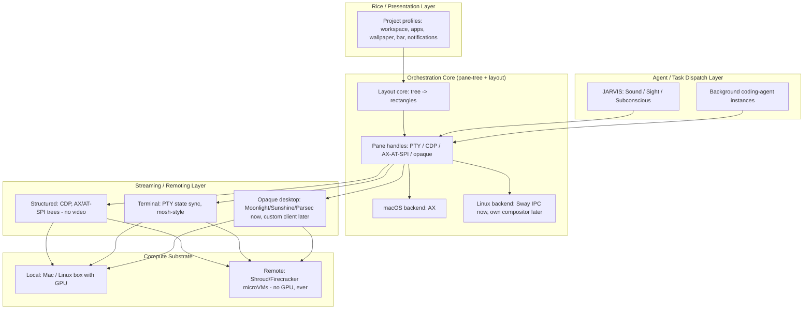

# Computing Mesh — Architecture & Component Boundaries

*Working design doc. Purpose: keep this project from sprawling by drawing hard lines
between components early. Each component should be buildable, testable, and
replaceable independently of the others.*

## 0. Vision

One session model — a tree of "panes" — that can be driven by a human or an agent,
addressed identically whether the content is a terminal, a browser, a native GUI app,
a remote desktop, or a background coding agent, and whether it's running on the
laptop in front of you, a Linux box across the room, or a GPU-less Firecracker
microVM. The laptop (or phone) becomes a thin client that supplies the two things
remote compute structurally lacks — a GPU and a human interface — and otherwise
gets out of the way.

Near-term, cheaper payoff: a resurrected Sway/rofi/dunst/Waybar rice, switchable
per-project, drivable by voice — which doubles as a working prototype of the whole
idea, built entirely on stock tools before any custom code exists.

## 1. Design principle

**Hard separation between orchestration, transport, compute, and agency.** None of
these four should know the internals of the others — they talk through narrow
interfaces (a pane-handle abstraction, an IPC/session protocol, a task-dispatch
call). This is what keeps four previously-separate categories of software (tiling
WM, tmux, remote desktop, agent runtime) from becoming one unmaintainable blob.

---

## 2. Component: Orchestration Core

**Responsibility.** Own the pane tree. Given a monitor/output and a tree of panes,
compute rectangles. Dispatch actions to panes. Nothing in this component renders
pixels or knows how a pane's content got to the screen.

**Not responsible for:** encoding, streaming, video, GPU work, or where a pane's
underlying process physically runs.

**Pane handle types** (the core doesn't care which a given pane is):

| Handle type | What it wraps | Structural or pixel? |
|---|---|---|
| PTY | a shell/terminal process | structural (escape sequences) |
| CDP | a browser tab via DevTools Protocol | structural (DOM/AX tree) |
| AX / AT-SPI tree | a native GUI app's accessibility tree | structural (widget tree) |
| Opaque | anything with no structural interface | pixels only (fallback) |

**Platform backends** (the "apply" step — same interface, different implementation):

- **macOS**: drives `AXUIElement` for move/resize/focus/observe. Runs entirely on
  the public Accessibility API — no SIP compromise in scope for v1 (see §8).
  Toggleable at runtime; never "becomes" the window manager, always a guest of one.
- **Linux, near-term**: bridge to Sway's IPC (`swaymsg`) — `get_tree`, `run_command`,
  event subscription. This is a real, working implementation of the layout-core
  interface using a mature, unmodified compositor. No compositor code to write.
- **Linux, long-term**: our own compositor (Smithay-based), replacing the Sway
  bridge without changing anything upstream of the backend boundary.

**Project profiles** live here: a small schema (workspace name, app list + working
directories + launch placement rules, wallpaper, color/theme overrides, bar/notif
config variant) that the orchestration core resolves into backend calls. Format
stays stable across the Sway-bridge → own-compositor migration; only the executor
changes.

---

## 3. Component: Streaming / Remoting Layer

**Responsibility.** Get a pane's state from wherever it lives to wherever a human
or agent needs to perceive/act on it. Strictly downstream of the orchestration
core — the core hands this layer a pane handle and a destination; this layer
doesn't touch the pane tree.

**By handle type:**

- **Structural (CDP, AX/AT-SPI)** — no streaming needed. Ship a tree diff and an
  action channel back. Cheap, works over vsock, this is the default and should
  cover most panes most of the time.
- **PTY** — mosh-style state sync (converge two copies of small terminal state)
  or tmux control-mode. Also cheap.
- **Opaque (pixels)** — the expensive, on-demand fallback, only for panes with
  no structural interface. Two tiers:
  - **Near-term (use today, off the shelf):** Sunshine (host, GPU-encoded) +
    Moonlight or Parsec (client). Already solves "stream my Linux box's desktop
    to my Mac" — no custom code. Multi-monitor auto-arrangement isn't fully
    turnkey in either; expect to configure layout once and have it persist.
  - **Long-term (custom):** our own thin client built against
    `moonlight-common-c` (decode) + macOS `ScreenCaptureKit` (local window
    capture), compositing both as GPU textures in one canvas we control. This
    is what makes true frame-level "mesh" compositing (remote desktop tiled
    next to a local terminal, no OS window chrome at the seam) possible —
    stock Moonlight/Parsec can't be embedded into, only run as their own window.

**Local vs. remote topology:** the laptop/phone is a *capability provider* (GPU +
screen + mic/speakers), not a display client. Local, GPU-dependent work runs
locally by necessity (camera, local hardware). Everything else defaults to
structural access; opaque streaming is invoked per-pane, on demand, torn down
when not attached.

---

## 4. Component: Compute Substrate

**Responsibility.** Actually run the processes behind pane handles.

- **Local**: the Mac or the Linux box with a real GPU. Used for anything GPU-bound
  or requiring local hardware (camera, audio interface, etc.).
- **Remote**: Shroud, our Firecracker microVM orchestrator. **Hard constraint, not
  a tuning problem**: Firecracker's device model is six emulated devices
  (virtio-net, virtio-balloon, virtio-block, virtio-vsock, serial console, keyboard
  controller) with no GPU device and no PCI passthrough path. Shroud microVMs will
  never have a GPU. Design around this as a given, not a v2 optimization.

**Open question (unresolved, tracked in §10):** Shroud was built for sub-100ms
ephemeral boot (Lambda/CI-style). A "desktop session" implies state that outlives
one boot — open tabs, running processes. Whether this becomes "suspend/resume a
long-lived microVM" vs. "reopen panes fresh each time" is a real fork, not a detail.

---

## 5. Component: Agent / Task Dispatch Layer

**Responsibility.** Decide what work happens and where, on behalf of a human or
autonomously. This layer *calls into* the orchestration core (spin up a pane, act
on a pane) — it does not itself know about layout, rendering, or compute placement.

**Reuses JARVIS's existing three-layer split:**

- **Sound (convo layer)** — the real-time voice loop. Tier-1 instant actions
  (e.g. "bring up the PedalKernel project") resolve deterministically and fire
  synchronously — this is where project-profile activation belongs.
- **Sight (presence layer)** — who's present, where, informs which node is "live"
  and what context/tools apply. Not core to this doc but shares infrastructure
  (identity, zone state) with node arbitration in the mesh.
- **Subconscious (background dispatch)** — anything beyond an instant action
  goes through `dispatch_task`. This is structurally the same shape as "spin up
  a pane, do work, report back" from the orchestration core — worth deciding
  explicitly (see §10) whether these become one dispatch system with two output
  modalities (speech, pixels) rather than two systems kept in sync by hand.

**Background coding-agent instances** (e.g. long-running coding-agent sessions)
are first-class panes, not a separate concept: a coding agent's session is a PTY
(or a structural handle, if it exposes one) like any other, whether it's running
locally or inside a Shroud microVM. It is reachable through the same session
server as everything else.

**Uniform accessibility.** Reachability and auth for *any* pane — local or remote,
human- or agent-driven — rides on infrastructure that already exists rather than
being invented per-component: FPL's Tailscale mesh for network reachability, and
the OIDC identity platform for tool/data scoping. A background agent instance in
a microVM and a terminal on your desk should be indistinguishable in how they're
addressed.

---

## 6. Component: Rice / Presentation Layer

**Status: near-term, decoupled, buildable today, no dependency on anything above.**

Stock Sway + Waybar + dunst + rofi, driven live via `swaymsg` IPC. This is a
genuine working implementation of "describe a change, see it happen instantly" —
`swaymsg run_command` mutates gaps/colors/borders/workspace assignment with no
restart. Project profiles (§2) can be prototyped entirely here before the
orchestration core exists in code: a profile is a script that fires `swaymsg`
calls, launches apps with placement rules, swaps the Waybar config/CSS variant,
and reloads dunst rules.

This layer's profile *schema* is meant to survive the eventual move to a
custom compositor; only the executor (Sway-IPC calls → native compositor calls)
changes.

---

## 7. Explicit non-goals (v1) — containing scope creep

- No SIP-gated macOS features (cross-space movement without flicker, shadow/anim
  removal). AX-only. Revisit only if AX proves insufficient in daily use.
- No custom Wayland compositor until the macOS backend + pane abstraction have
  been proven in real daily use against the Sway bridge.
- No GPU inside any Shroud microVM, ever — design around this, don't wait to hit it.
- No default opaque-pixel/video path — it's an on-demand fallback for panes with
  no structural interface, not the common case.
- No bespoke remoting protocol before exhausting off-the-shelf options
  (Sunshine/Moonlight/Parsec, Waypipe, PipeWire portals).

## 8. Sequencing

1. **Now** — Resurrect the Sway/rofi/dunst/Waybar rice; prototype NL-driven live
   editing via `swaymsg`; stand up Sunshine + Moonlight/Parsec between the Linux
   box and the Mac for pragmatic remote-desktop access.
2. **Next** — Build the orchestration core + macOS (AX) backend; make it the daily
   driver on the Mac; this is where the pane-handle abstraction gets stress-tested
   against real use, before investing in anything heavier.
3. **Then** — Formalize project profiles against the real core (not just the Sway
   prototype); wire JARVIS's tier-1 dispatch to profile activation.
4. **Then** — Formalize the session server/gateway; bring background coding-agent
   instances in as pane handles; wire in Tailscale/OIDC for uniform access.
5. **Then** — Write the Linux backend (Smithay compositor), retiring the Sway-IPC
   bridge, once the interface it implements has already been proven correct.
6. **Long-term** — Custom thin client (`moonlight-common-c` + `ScreenCaptureKit`)
   replacing off-the-shelf Moonlight/Parsec for true frame-level compositing —
   the actual "mesh" visual experience.

## 9. Open questions (tracked, not blocking)

- **Session-server locality**: one session server per microVM, or one server
  scheduling panes across a pool of microVMs?
- **Shroud persistence model**: suspend/resume long-lived microVMs vs. fast
  ephemeral boot with panes reopened each time — conflicts with Shroud's
  original sub-100ms-boot design goal and needs a deliberate answer.
- **Dispatch unification**: does `dispatch_task` (JARVIS) merge with pane-tree
  task dispatch into one system with two output modalities, or stay separate?
- **Multi-person-at-one-node disambiguation** (inherited from JARVIS's
  subconscious design): relevant if mesh nodes are ever shared/multi-user, not
  yet solved there either.
