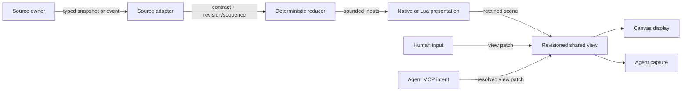

# Canvas shared visualization plane

Canvas is the common visual surface between a person, agents, and data-owning
systems. It presents finite artifacts and live sources through the same lifecycle.
An image, PDF, inbox summary, camera, market feed, Elmer's graph events, and an
agent-generated explanation differ in source contract and update cadence. They do
not require separate window systems.

The key shared object is a **view**, not a screenshot. A view names one or more
authorized sources and records the exact visual context applied to them: source
revisions or stream sequences, viewport, attention region, page or playhead,
filters, and view revision. Human interaction and agent tools observe and mutate
that same state.
If an agent zooms into part of an image before inspecting it, Canvas shows that
zoom and attention region. If a person changes the page or filter, the next agent
inspection sees the new revision.

## Boundaries

The source owner retains data acquisition, authorization, credentials, transport,
and domain semantics. Canvas stores only stable owner/source/contract identity and
the last applied source position. A source may be a finite artifact at an exact
revision or a stream followed live or held at a replayable sequence. SSE, a local
file, IMAP, a camera protocol, and an application API are transport adapters; they
do not become Canvas document concepts.

Canvas owns revisioned view state, layout, presentation, interaction, rendering,
and capture. The same view must feed the physical display and any agent-facing
capture. Captures identify the view revision and source positions they rendered so
the agent cannot silently reason about pixels different from those shown to the
person.

Rust owns validation and deterministic transitions. Known source contracts can
use native reducers. Capability-scoped Lua handles small adaptive presentation
logic by mapping bounded typed snapshots and events into retained scenes. Lua has
no network, filesystem, credential, process, wall-clock, decoder, or GPU access.
It runs only when the host supplies an input or interaction event; the render loop
does not execute it.

MCP is the intent and observation boundary. An LLM may resolve “show the invoice
from last week” to an exact authorized source and propose a desired view. The
owner-local socket inspects current state, computes and applies the deterministic
revision-checked transition, and returns the resulting view revision. Models do
not own layout reconciliation, transport, retries, or stream scheduling.

## State flow

The data path is incremental. A stream event updates the source position and only
the affected retained presentation state. Frame scheduling remains demand-driven:
static views stay idle, while animation or video backends request bounded frames.
Several sources can feed one view, and one source can feed several views, without
copying ownership or credentials into Canvas.

## Manual runbook

The automated path must remain explainable as these steps:

1. Resolve a request to exact authorized source owners, IDs, and contracts.
2. Read or create the shared view and note its current revision.
3. Fetch a bounded snapshot or subscribe from a known stream sequence.
4. Apply the native or capability-scoped Lua reducer for that contract.
5. Patch viewport, attention, navigation, filters, or presentation at the observed
   view revision.
6. Render the resulting revision on Canvas.
7. When agent vision is needed, capture that same view revision and source
   positions.
8. On conflict, inspect again and recompute; never replay a blind mutation.

The first protocol types live in `dock_canvas::view`. Runtime mounting, MCP tools,
capture coupling, and stream adapters build on that contract rather than creating
parallel representations.
