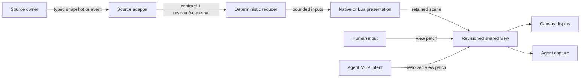

# Canvas shared visualization plane

Canvas is the common visual surface between a person, agents, and data-owning
systems. It presents finite artifacts and live sources through the same lifecycle.
An image, PDF, inbox summary, camera, market feed, Elmer's graph events, and an
agent-generated explanation differ in source contract and update cadence. They do
not require separate window systems.

Canvas is also the shared view and window manager for human-agent collaboration.
It supports two equally important working modes. In a steering view, a person can
watch infrastructure, agents, workflows, machines, and live signals and act
through the system that owns them. In a deep-work view, the same desktop can hold
terminals, code, engineering artifacts, instruments, video, and explanations for
hands-on work such as PedalKernel or CFT. Switching modes does not discard either
workspace.

The key shared object is a **view**, not a screenshot. A view names one or more
authorized sources and records the exact visual context applied to them: source
revisions or stream sequences, viewport, attention region, page or playhead,
filters, and view revision. Human interaction and agent tools observe and mutate
that same state.
If an agent zooms into part of an image before inspecting it, Canvas shows that
zoom and attention region. If a person changes the page or filter, the next agent
inspection sees the new revision.

## Boundaries

The source owner retains data acquisition, authorization, credentials, transport,
and domain semantics. Canvas stores only stable owner/source/contract identity and
the last applied source position. A source may be a finite artifact at an exact
revision or a stream followed live or held at a replayable sequence. SSE, a local
file, IMAP, a camera protocol, and an application API are transport adapters; they
do not become Canvas document concepts.

Canvas owns revisioned view state, layout, presentation, interaction, rendering,
and capture. The same view must feed the physical display and any agent-facing
capture. Captures identify the view revision and source positions they rendered so
the agent cannot silently reason about pixels different from those shown to the
person.

Rust owns validation and deterministic transitions. Known source contracts can
use native reducers. Capability-scoped Lua handles small adaptive presentation
logic by mapping bounded typed snapshots and events into retained scenes. Lua has
no network, filesystem, credential, process, wall-clock, decoder, or GPU access.
It runs only when the host supplies an input or interaction event; the render loop
does not execute it.

MCP is the intent and observation boundary. An LLM may resolve “show the invoice
from last week” to an exact authorized source and propose a desired view. The
owner-local socket inspects current state, computes and applies the deterministic
revision-checked transition, and returns the resulting view revision. Models do
not own layout reconciliation, transport, retries, or stream scheduling.

## One view language

The portable language has a few deliberately small layers:

| Layer | Durable representation | Responsibility |
|---|---|---|
| Source binding | Typed owner, ID, contract, revision or sequence | Identifies authorized data without copying its transport or credentials |
| Shared view | Versioned JSON document | Records sources, viewport, attention, navigation, filters and presentation state |
| Workspace | Versioned JSON document | Records tiling or freeform layout, z-order, theme and project context across monitors |
| Change journal | Ordered JSONL patches and receipts | Replays meaningful human and agent state changes and supports device handoff |
| Presentation logic | Capability-scoped Lua plus known templates | Turns bounded typed data into retained scenes and interactions |
| Assets | Immutable content-addressed references | Carries images, documents, meshes, media and generated outputs |

JSON snapshots make current state cheap to load and validate. JSONL is the
append-only revision journal; it does not replace compacted snapshots or become a
second source of current truth. Layout can be tiled, stacked, or freeform and is
independent of the renderer and physical monitor topology.

A useful mid-session artifact can therefore be as small as a known template,
typed CSV or JSON data, and bounded Lua that describes the presentation. Static
data may still have host-driven narrative animation: the host supplies explicit
timeline or pulse events, while Lua remains deterministic and cannot read its own
clock. A Maxim/3Blue1Brown-style adapter can compile richer authored explanations
into the same scene and timeline language.

## Reference workloads

These workloads test the common language rather than defining special cases in
the core:

| Family | Initial examples | View behavior |
|---|---|---|
| Live graphs | Elmer's brain map, MCP firing activity, Edgerunner agent DAGs | Ordered graph events, visible firing/activity, selection and topology changes |
| Metrics and signals | Prometheus gauges, meters, oscilloscopes, presence | Bounded samples, legends, thresholds, windows and live/held positions |
| Maps and spatial data | Panopticon, RuView, PolyLayout | Typed layers, camera state, picking, provenance and streaming updates |
| Markets and analysis | TradingView projections, mixed-export analysis | Several owners in one comparable chart, filters, annotations and replay |
| Engineering | STL/STEP/wireframe, Gaussian splats, FEA, microscope and CAM views | Native 2D/3D cameras, units, picking, animation, LOD and source fidelity |
| Media | Music visualizers, NVR/video streams | Time-aligned streams, playback state and GPU-backed frames |
| Work surfaces | Terminals, code, generated briefs and interactive presentations | Direct interaction, project recall, agent attention and human takeover |

Domain systems remain authoritative. Canvas can show and steer an FEA run, CNC
job, audio interface, deployment, or agent tree through a typed owner API; device
drivers, CAM semantics, deployment policy, and physical actuation remain with the
systems built to own them.

## Mobility, presence, and control

An authenticated machine can reconstruct a view from its workspace snapshot,
JSONL revision journal, source references, Lua/template versions, and immutable
assets. GPU handles, decoded frames, native window IDs, endpoints, and credentials
remain local and reconstructible. Mobile, desktop, browser/WASM, and future XR
renderers consume the same validated state according to their capabilities.

JARVIS owns voice and presence observations. Canvas exposes typed view intent and
presentation targets. A deterministic routing policy can move or mirror the
active shared view to the device and screens where the person is present, while
retaining every other project workspace. Voice requests resolve through MCP to
exact sources and desired state before the socket applies them.

Alfalfa owns project/resource identity, workflows, automation, and business
administration. Canvas owns joint view state, layout, interaction, capture, and
presentation. Source systems own data and actions. Platform helpers own native
windows, displays, USB switching, audio/video devices, and other OS integration.
This keeps routine infrastructure and administrative work automatable while the
interactive surface stays focused on engineering and creative work.

The same boundaries can support a later Canvas/JARVIS Linux environment, Android
client, XR runtime, and lab endpoints. Modern Linux support for industrial
hardware, Ghidra-assisted protocol work, CNC/CAM ownership, Focusrite/Linux audio,
screen routing, and maximum USB switching belong in dedicated capability owners
that publish state and actions to Canvas. They do not require hardware logic in
the renderer.

## State flow

The data path is incremental. A stream event updates the source position and only
the affected retained presentation state. Frame scheduling remains demand-driven:
static views stay idle, while animation or video backends request bounded frames.
Several sources can feed one view, and one source can feed several views, without
copying ownership or credentials into Canvas.

## Manual runbook

The automated path must remain explainable as these steps:

1. Resolve a request to exact authorized source owners, IDs, and contracts.
2. Read or create the shared view and note its current revision.
3. Fetch a bounded snapshot or subscribe from a known stream sequence.
4. Apply the native or capability-scoped Lua reducer for that contract.
5. Patch viewport, attention, navigation, filters, or presentation at the observed
   view revision.
6. Render the resulting revision on Canvas.
7. When agent vision is needed, capture that same view revision and source
   positions.
8. On conflict, inspect again and recompute; never replay a blind mutation.

The first protocol types live in `dock_canvas::view`. Runtime mounting, MCP tools,
capture coupling, and stream adapters build on that contract rather than creating
parallel representations.
