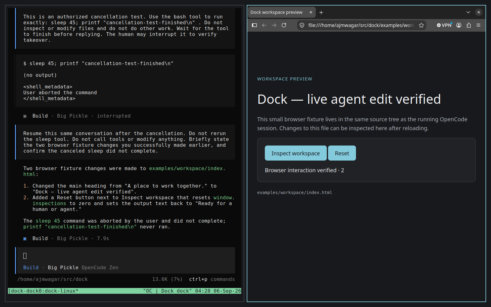

# Work in a shared project desktop

Start the iced shell on the Mac:

```sh
cargo run -p dock-mac -- --connect-project dock
```

The normal interface is a small keyboard companion. While Dock is running,
**Ctrl+Option+Space** summons it. Choose a project with **Cmd+1 / Cmd+2**, or use
its project picker. Dock restores the existing conversation, terminal and browser,
opens or reuses the live desktop viewer, and gets out of the way.

To work with the agent, summon the companion, type in its single prompt field and
press **Enter**. This submits to the project's existing OpenCode conversation and
automatically grants control for the work. **Escape** revokes control and asks
OpenCode to interrupt; there is no separate control button to manage. The
companion returns control after observing a new completed response and idle
session. A subsequent prompt continues the same conversation.

The latest assistant response and progress appear in the companion. Capture,
focus, click, key and session APIs remain available to agents through the CLI.
The earlier detailed controls and Mac restoration tools are accessible only with
`--diagnostics`; they are not the everyday interface.

The Linux desktop contains a real OpenCode terminal and Firefox showing the
project's editable browser fixture. Dock's fixture lives in
`~/src/dock/examples/workspace/index.html`; Studio uses `~/src/dock-studio/index.html`.
These are small test applications, not a replacement for Dock's iced GUI.

The complete working sequence is to open Dock, ask for an edit, observe the real
change in Firefox, interrupt ongoing work, switch to Studio, then return to Dock.
The original windows and conversation remain. Switching projects changes
visibility; it does not automatically suspend inference or freeze processes.

Direct typing in OpenCode's terminal uses OpenCode itself; the Dock latch governs
cooperating orchestration clients, not all processes belonging to the OS user.
Normal viewer input stays available to the human. No global keyboard injection
or Accessibility bypass is used by the summon shortcut.

## Transport and ownership

The independent Sway compositor owns a virtual Wayland seat. wayvnc transports
that seat's frames and human input; the Rust desktop adapter targets the same
compositor for agent input. The service listens on Linux loopback port 5901.
An authenticated SSH tunnel binds Mac loopback port 15901. TigerVNC uses the
certificate fetched over SSH and a private generated credential passed only in
its environment, not its arguments.

Sunshine/Moonlight remains available for the original GNOME desktop. Its stream
and the earlier nested Hyprland experiment are separate from this project
desktop. No lock screen was bypassed. Native Mac window rearrangement still uses
the separately installed Dock Control helper; its Accessibility grant is not
needed for the Linux project desktop or its agent controls.

See [OpenCode lifecycle and API](opencode-sessions.md) and
[Mac display reservation](mac-stream-display.md) for their precise scopes.

## Live evidence

The Mac received complete 1600×1000 frames through the authenticated VNC tunnel.
A pointer click changed the actual browser counter from 1 to 2; Tab and Return
activated Reset and restored its initial text. These tests used the streaming
protocol's input messages, independently of the compositor control CLI.




`scripts/verify-desktop-stream.py` is the optional Python/Pillow transport test
harness used on the Mac. With the viewer tunnel already open, no arguments only
captures the desktop; explicit `X Y` sends a click, and `--keyboard` sends Tab and
Return. Run input variants only with the browser fixture focused. It reads the
private credential over SSH and saves frames in `/private/tmp`; it never prints
the credential. This harness is not part of Dock's Rust runtime.
